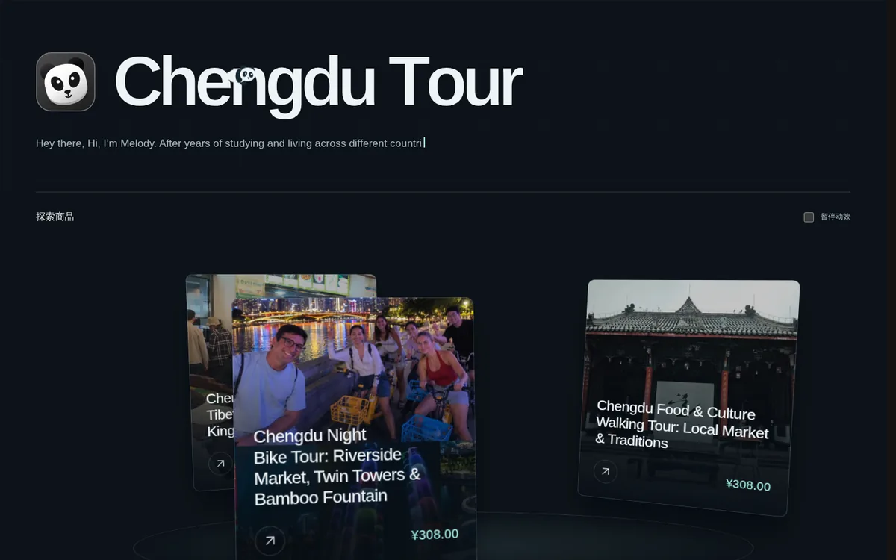

# 案例：Chengdu Tour（eileenpeng.com）

  

[Chengdu Tour](https://www.eileenpeng.com) 是一位成都本地向导面向海外游客的英文小团游店铺：夜骑锦江、美食市场漫步、藏族街区与三国历史徒步等。它卖的是**服务和体验**而不是实物，说明 MercLink 的「目录 + 字段 + 规格」模型同样适用于非实物商品。

## 和童心珠宝有什么不同

|            | [童心珠宝](txpearl.md)          | Chengdu Tour                                     |
| ---------- | ------------------------------- | ------------------------------------------------ |
| 商品类型   | 实物珍珠首饰                    | 本地导览服务                                     |
| 语言与受众 | 中文，国内买家                  | 英文，海外游客                                   |
| 店面风格   | 深海蓝 + 金色品牌首屏、卖点卡片 | 深色背景、熊猫头像 Logo、打字机简介、3D 卡片轮播 |
| 主域名     | 裸域 `txpearl.cn`               | `www.eileenpeng.com`（裸域 301 到 www）          |

## 它是怎么搭起来的

和童心珠宝一样，这家店跑在一套标准的 MercLink 部署上，店面通过 `/storefront/skill.md` 的「下载源码 → 修改 → `node accept.mjs` 验收 → 上传 → 确认激活」流程替换成了完全自定义的设计。

可以直接核对它是 MercLink 店：

- `/llms.txt`、`/skill.md`、`/merchant/skill.md`、`/storefront/skill.md` 都可访问，内容是同一套 Skill；
- `/api/v1/store` 返回标准的 `{ "code", "message", "data", ... }` 响应外壳；
- `/index.md`、`/products.md`、`/sitemap.xml`、`/robots.txt` 由服务端生成；
- 页面 `<head>` 里有服务端加上的 `canonical`、`alternate`（`text/markdown`）链接。

店面换成了自己的 HTML 和动效，但商品名称、价格、库存等事实仍由服务端槽位渲染，Agent 读到的数据和人看到的页面始终一致。

详细的开店步骤可以参考 [童心珠宝的完整上线过程](txpearl.md)。
